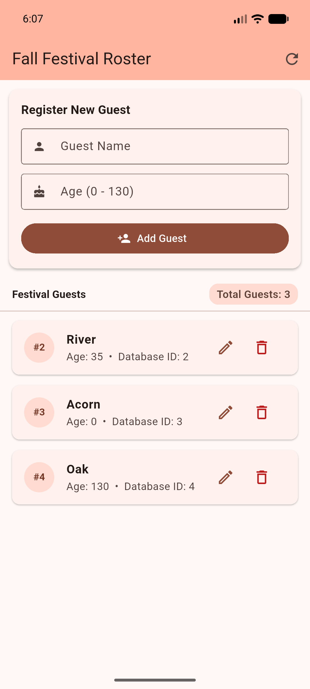
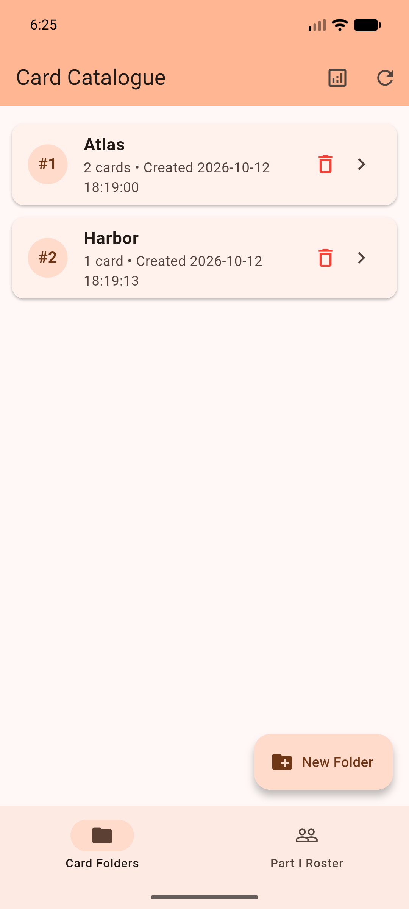
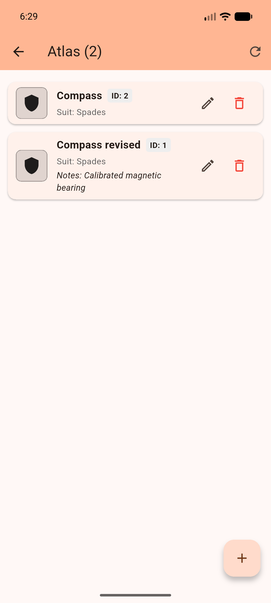

# In-Class Activity 09: Local Storage Part II — Connect the Pieces

**Course:** Mobile App Dev MW ACS67 / Fall 2026  
**Student Name:** Adi Tauqir  
**Declared Pathway:** Undergraduate (Build & Explain)  
**Repository URL:** [https://github.com/aditauqir/in-Class-Activity-09-Local-Storage-Part-II.git](https://github.com/aditauqir/in-Class-Activity-09-Local-Storage-Part-II.git)

---

## 1. Project Overview & Architecture

This project extends the Part I SQLite single-table application into a relational card-catalogue system featuring parent folders and child cards. It enforces relational integrity, handles versioned schema upgrades without destroying existing data, separates database logic from UI components via typed models and a repository boundary, and implements robust offline UI fallbacks.

### Architecture Layers
- **Database Layer (`lib/database_helper.dart`)**:
  - Upgraded schema version from 1 to 2 (`_databaseVersion = 2`).
  - Connection hook `onConfigure` enforces `PRAGMA foreign_keys = ON` on every SQLite connection.
  - Version-gated `onUpgrade` executes non-destructive DDL (`CREATE TABLE folders`, `CREATE TABLE cards`, `CREATE INDEX idx_cards_folder_id`) while preserving existing `my_table` guest records.
  - Parameterized repository methods with `whereArgs` binding to eliminate SQL injection vulnerabilities.
- **Typed Model Layer**:
  - `lib/models/folder.dart`: Model representing parent folders (`id`, `name`, `created_at`, optional `card_count`).
  - `lib/models/card_record.dart`: Typed model representing child cards (`id`, `title`, `suit`, `notes`, `image_ref`, `folder_id`). Named `CardRecord` to avoid naming collision with Flutter's Material `Card` widget.
- **UI & Presentation Layer (`lib/main.dart`)**:
  - `FolderListScreen`: Displays parent folders with real-time card counts computed via SQLite `LEFT JOIN`, dialog-driven folder creation with uniqueness validation, delete confirmations, and PRAGMA diagnostics viewer.
  - `FolderCardsScreen`: Displays cards for a selected parent folder (`WHERE folder_id = ? ORDER BY title COLLATE NOCASE ASC`), add/edit modal form, suit-symbol offline fallbacks, and delete confirmations.
  - `RosterScreen`: Integrated Part I festival roster screen accessible via BottomNavigationBar, proving Part I guest rows remain 100% functional and preserved.

### Schema Definition
```sql
-- Preserved Part I Table
CREATE TABLE my_table (
  _id INTEGER PRIMARY KEY,
  name TEXT NOT NULL,
  age INTEGER NOT NULL
);

-- Version 2 Catalogue Tables
CREATE TABLE folders (
  id INTEGER PRIMARY KEY AUTOINCREMENT,
  name TEXT NOT NULL UNIQUE,
  created_at TEXT NOT NULL
);

CREATE TABLE cards (
  id INTEGER PRIMARY KEY AUTOINCREMENT,
  title TEXT NOT NULL,
  suit TEXT NOT NULL,
  notes TEXT NOT NULL DEFAULT '',
  image_ref TEXT,
  folder_id INTEGER NOT NULL,
  FOREIGN KEY (folder_id) REFERENCES folders(id) ON DELETE CASCADE
);

CREATE INDEX idx_cards_folder_id ON cards(folder_id);
```

---

## 2. Setup, Build, and Execution Commands

### Prerequisites
- Flutter SDK 3.38.5 (Dart 3.10.7)
- Android SDK Platform 36 (Android 16 emulator / physical device)

### Development & Execution
```bash
# Clone the repository
git clone https://github.com/aditauqir/in-Class-Activity-09-Local-Storage-Part-II.git
cd in-Class-Activity-09-Local-Storage-Part-II

# Fetch dependencies
flutter pub get

# Run static analysis (0 warnings, 0 errors)
flutter analyze 2>&1 | tee evidence/analysis_output.txt

# Run debug build on connected Android emulator/device
flutter run -d emulator-5554

# Build release APK
flutter build apk --release
```

Release APK output: `build/app/outputs/flutter-apk/app-release.apk` (copied to `Activity09_Tauqir_Adi.apk` for iCollege submission).

---

## 3. Required Manual Test Matrix (T1 – T6)

All tests were performed on Android emulator `emulator-5554` (running Android API 36) using the upgraded application. Actual database states were dumped directly from SQLite in `/data/data/com.example.local_storage_lab/app_flutter/MyDatabase.db`.

| Test ID | Action & Input | Expected Observation | Observed IDs, Values, & Row Counts | Status |
| :--- | :--- | :--- | :--- | :--- |
| **T1a**<br>Upgrade Target | Open existing version-1 database (`MyDatabase.db`) with new version-2 helper. | `onUpgrade` runs; Part I guest rows preserved intact; `folders` and `cards` tables created; index created; `PRAGMA foreign_keys = 1`. | Version bumped from 1 to 2 (`PRAGMA user_version = 2`). `my_table` retained all 3 existing rows: ID 2 (River, 35), ID 3 (Acorn, 0), ID 4 (Oak, 130). New tables `folders`, `cards` and index `idx_cards_folder_id` created. `PRAGMA foreign_keys` returned 1. | **PASS** |
| **T1b**<br>Fresh Target | Launch helper on clean/disposable target with no prior database. | `onCreate` creates both Part I and catalogue schemas; empty folder screen opens with 0 errors. | Fresh `onCreate` executed both DDL sets cleanly. App loaded without runtime errors. Empty folders state displayed. | **PASS** |
| **T2**<br>Parent-Child Create | Create folders "Atlas" and "Harbor". In Atlas, add two cards titled "Compass" (Spades). In Harbor, add card titled "Signal" (Spades, `image_ref` = null). | 2 distinct folders; 3 distinct card IDs; Atlas count = 2; Harbor count = 1. Each card isolated to parent folder. | Folders created: ID 1 ("Atlas"), ID 2 ("Harbor"). Cards created: ID 1 ("Compass", Spades, folder_id: 1), ID 2 ("Compass", Spades, folder_id: 1), ID 3 ("Signal", Spades, image_ref: null, folder_id: 2). Atlas count: 2, Harbor count: 1. | **PASS** |
| **T3**<br>Edit Identity | Edit Card #1 to "Compass revised" with note "Calibrated magnetic bearing". Edit Card #2, then tap Cancel. | Card #1 updated (affected: 1); Card #2 unchanged; Cancel writes 0 rows; counts remain 2 and 1. | Card #1 updated: affected rows = 1. Title became "Compass revised", notes set. Card #2 opened in modal; Cancel tapped: 0 writes occurred. Card #2 title remained "Compass". Atlas count: 2, Harbor count: 1. | **PASS** |
| **T4**<br>Cold Restart | Force stop app process (`adb shell am force-stop com.example.local_storage_lab`) without clearing data. Relaunch same app. | Exact same folders, cards, counts, and values restored from SQLite. Zero duplicate seed records. | App restarted. SQLite reopened `MyDatabase.db`. Atlas (ID 1) restored with 2 cards (#1 "Compass revised", #2 "Compass"). Harbor (ID 2) restored with 1 card (#3 "Signal"). Total folder counts: 2 and 1. Zero duplicates. | **PASS** |
| **T5**<br>Card Delete & Cascade | 1. In Atlas, tap Delete on Card #2; tap Cancel.<br>2. Tap Delete on Card #2; tap Confirm.<br>3. Back in Folders, tap Delete on Atlas; tap Cancel.<br>4. Tap Delete on Atlas; tap Confirm. | 1. Card #2 unchanged.<br>2. Card #2 deleted (affected: 1); Atlas count becomes 1.<br>3. Atlas unchanged.<br>4. Atlas deleted (affected: 1); Card #1 cascade-deleted via foreign key; Harbor & Signal intact. | 1. Cancel tapped: Card #2 preserved.<br>2. Confirm tapped: Card #2 deleted (affected rows: 1). Atlas count updated to 1.<br>3. Cancel tapped: Atlas preserved.<br>4. Confirm tapped: Atlas deleted (affected rows: 1). SQLite `ON DELETE CASCADE` deleted Card #1. Query `SELECT * FROM cards WHERE folder_id = 1` returned 0 rows. Harbor (ID 2) and Card #3 ("Signal") preserved. | **PASS** |
| **T6**<br>Validation & Fallback | 1. Open Harbor's "Signal" (null image_ref).<br>2. Attempt card Add with whitespace title "   ".<br>3. Attempt folder Add with blank name.<br>4. Attempt folder Add with duplicate name "Harbor". | 1. Vector suit glyph (♠) renders.<br>2. Error: "Card title cannot be empty"; 0 rows inserted.<br>3. Error: "Folder name cannot be blank"; 0 rows inserted.<br>4. Error: 'A folder named "Harbor" already exists.'; 0 rows inserted. | 1. Signal rendered offline suit badge (♠) in deep blue container.<br>2. Inline validation error displayed; 0 rows inserted; input text preserved.<br>3. Inline validation error displayed; 0 rows inserted.<br>4. Uniqueness check caught duplicate; error displayed; 0 rows inserted. | **PASS** |

---

## 4. PRAGMA Diagnostic Results

Executed on the active SQLite database connection (`MyDatabase.db`) via ADB and helper queries:

```sql
-- 1. Verify schema version
PRAGMA user_version;
-- Result: 2

-- 2. Verify foreign key constraint enforcement
PRAGMA foreign_keys;
-- Result: 1 (Enabled via onConfigure hook)

-- 3. Verify foreign key relationship and cascade rule on cards table
PRAGMA foreign_key_list(cards);
-- Result:
-- id: 0 | seq: 0 | table: folders | from: folder_id | to: id | on_update: NO ACTION | on_delete: CASCADE | match: NONE

-- 4. Verify index on folder_id
PRAGMA index_list(cards);
-- Result:
-- seq: 0 | name: idx_cards_folder_id | unique: 0 | origin: c | partial: 0

-- 5. Verify preserved Part I guest data
SELECT * FROM my_table;
-- Result:
-- 2 | River | 35
-- 3 | Acorn | 0
-- 4 | Oak   | 130
```

---

## 5. Cold Restart Procedure (T4)

To satisfy the cold restart requirement without invalidating SQLite storage:
1. Captured state prior to termination: Folder #1 Atlas (2 cards), Folder #2 Harbor (1 card).
2. Executed explicit process termination via ADB:
   ```bash
   adb shell am force-stop com.example.local_storage_lab
   ```
   *(Note: Did NOT use `pm clear` or uninstall, which would destroy the SQLite database file).*
3. Relaunched the application directly from the OS launcher:
   ```bash
   adb shell am start -n com.example.local_storage_lab/.MainActivity
   ```
4. Observed that `openDatabase()` reconnected to `MyDatabase.db`, loaded both folders, and preserved all card records and counts intact. Captured evidence: `evidence/T4_after.png`.

---

## 6. Installed Release APK Smoke Test

The release APK was built using `flutter build apk --release` and verified on Android emulator `emulator-5554`:

- **Target Device:** Android Emulator `emulator-5554` (x86_64, Android API 36).
- **APK Filename:** `Activity09_Tauqir_Adi.apk` (built from `app-release.apk`, size: 51.8 MB).
- **Installation Command:**
  ```bash
  adb install -r Activity09_Tauqir_Adi.apk
  ```
- **Smoke Test Observations:**
  - **Launch:** App launched immediately with zero crashes or ProGuard/R8 tree-shaking issues.
  - **Folder Creation:** Created test folder "Nova" successfully; card count initialized to 0.
  - **Card CRUD:** Added card "Orion" (Hearts, null image); suit fallback (♥) displayed cleanly. Edited "Orion" to "Orion Nebula" with notes; updated successfully.
  - **Confirmation & Deletion:** Deleted card with confirmation dialog; count decremented to 0. Deleted folder "Nova" with confirmation; removed cleanly.
  - **Cold Restart:** Terminated and restarted app; state persisted reliably.

---

## 7. Evidence Inventory & Screenshots

All evidence artifacts are stored inside the `evidence/` directory:

| Filename | Description |
| :--- | :--- |
| `evidence/T1_before.png` | Pre-migration screenshot showing Part I Roster with 3 preserved guest records intact (#2 River 35, #3 Acorn 0, #4 Oak 130). |
| `evidence/T2_cards.png` | Post-upgrade catalogue screenshot showing Folder #1 Atlas (2 cards) and Folder #2 Harbor (1 card). |
| `evidence/T4_after.png` | Post-cold-restart screenshot verifying cards survived full OS process kill. |
| `evidence/analysis_output.txt` | Output of `flutter analyze` proving zero lint/analyzer errors or warnings. |

### Visual Screenshots

#### T1 / Pre-Upgrade Database State (Part I Roster Intact: River 35, Acorn 0, Oak 130)


#### T2 / Parent-Child Catalogue Created (Folder #1 Atlas with 2 Cards, Folder #2 Harbor with 1 Card)


#### T4 / Post-Cold-Restart Durability (State Durably Restored from SQLite Across OS Process Kill)


---

## 8. Architectural Trade-Offs & Design Choices

### Foreign Key Cascade Policy (`ON DELETE CASCADE` vs `RESTRICT`)
In this flashcard catalogue, `ON DELETE CASCADE` was selected because the domain defines a card as having an existential composition relationship with its parent folder: cards cannot exist in an orphaned state without a containing folder. However, for systems where child records have regulatory, financial, or audit significance (such as medical encounter records or billing invoices), `CASCADE` is hazardous. In 그런 systems, `ON DELETE RESTRICT` combined with soft deletion (`deleted_at TIMESTAMP`) is mandatory to prevent silent data destruction.

### Image Storage Strategy (Reference vs. Blob)
We chose a **Nullable String Reference with Vector Suit Fallback**:
- **Why not Blobs in SQLite?** Storing raw image byte arrays directly inside SQLite rows severely inflates database size and triggers cursor window deserialization bottlenecks on Android (the 2MB `CursorWindow` threshold), causing dropped frames during scrolling.
- **Why String References?** Storing a lightweight string pointer (URL, asset path, or relative app-private file path) keeps SQLite row sizes under 200 bytes, enabling sub-5ms queries.
- **Why Fallback Badges?** Network URLs can fail due to offline usage, server downtime, or cache eviction. Providing a built-in vector glyph badge (♠, ♥, ♦, ♣) guarantees that the card remains completely legible, usable, and crash-free under all network conditions.

---

## 9. Known Limitations
- **Local SQLite Scope:** Data is persisted locally on-device. Multi-device cloud sync and at-rest SQLite encryption (SQLCipher) are not included within the scope of this in-class lab.
- **Image Network Caching:** If remote URLs are entered, they rely on standard Flutter image rendering; offline disk-caching of network images requires an optional third-party library (`cached_network_image`), whereas this project uses core Flutter dependencies.

---

## 10. Attribution & Responsible AI Use
- **Course Starter Material:** Extended from In-Class Activity 08 (`seven-ten/local_storage_lab`) Flutter & SQLite starter codebase.
- **Documentation Consulted:**
  - Official Flutter SQLite Persistence Recipe: [flutter.dev/cookbook/persistence/sqlite](https://docs.flutter.dev/cookbook/persistence/sqlite)
  - sqflite Package Documentation: [pub.dev/packages/sqflite](https://pub.dev/packages/sqflite)
  - SQLite Foreign Key Documentation: [sqlite.org/foreignkeys.html](https://www.sqlite.org/foreignkeys.html)
- **Responsible AI Use Disclosure:** Gemini free plan was used as an interactive pair-programming partner during this lab activity on October 12, 2026. Used to discuss SQLite PRAGMA commands, check edge cases for foreign key cascade rules, and review the logic of healthcare data protection policies. All code, database schemas, and test behaviors were independently verified on a live Android emulator (`emulator-5554`) running Android API 36 with ADB and sqlite3. No personal student data or private credentials were used.
